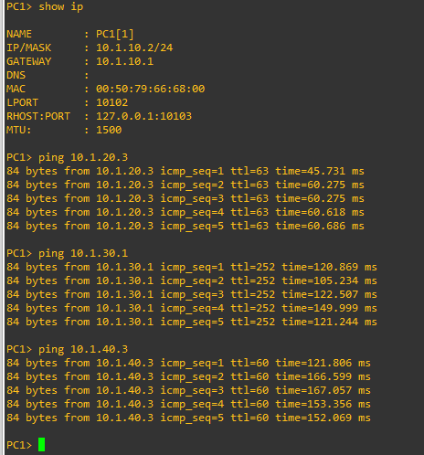
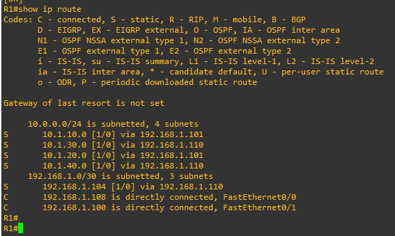
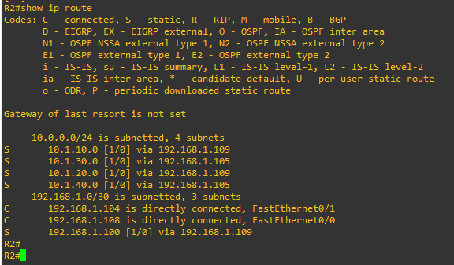
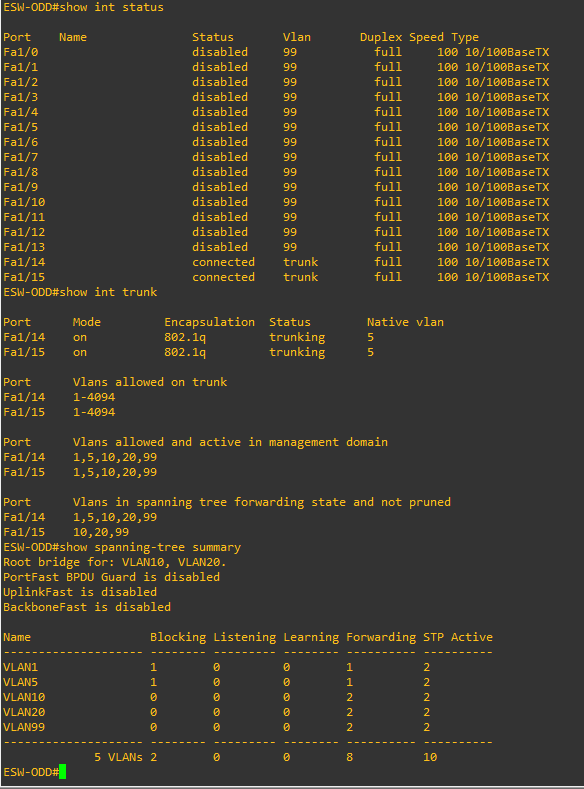
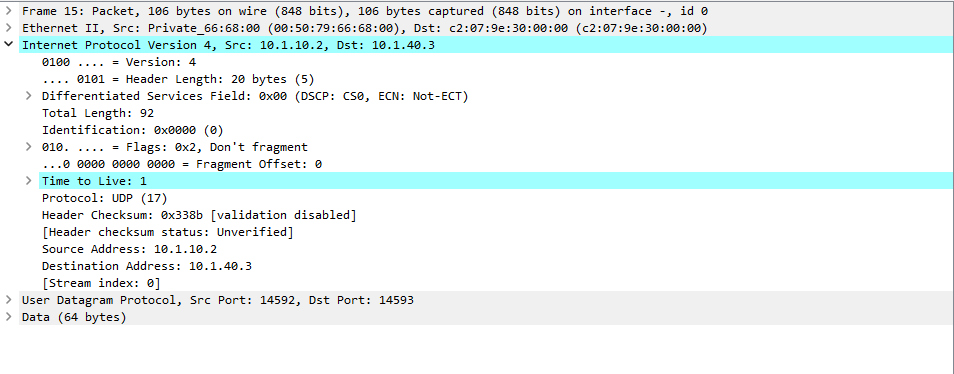
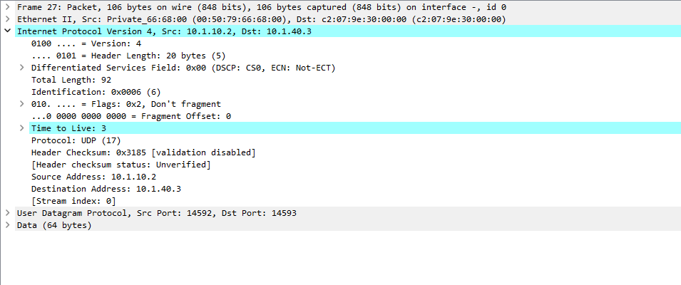
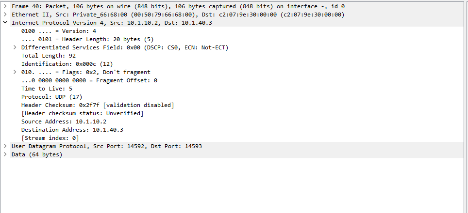

# gns3project
GNS3 Project

# Lucas Keller - GNS3 Networking 

## Purpose

The purpose of static routes is to manually direct network traffic along a chosen path. They are useful when an administrator wants predictable routing. If IP addresses or network layouts change often, static routes can require more manual updates.

## What can happen if a static route is misconfigured?

A misconfigured static route, such as one with the wrong next-hop IP address, can cause traffic to fail to reach its destination or take an unintended path. A next hop that is not reachable through a directly connected network may prevent the route from being installed in the routing table. Incorrect routes can also contribute to routing loops.

## How can you verify a static route?

Use `show ip route` on the router and check that the expected route appears with an `S` entry and the correct destination network, mask or prefix length, and next hop. You can also ping the next hop and destination. To test end-to-end connectivity and return paths, ping from a host in the appropriate VLAN on a non-distribution switch.

## How does traceroute help verify the route?

The `traceroute` command shows the hops a packet takes toward its destination. Comparing the reported hops with the intended topology helps confirm whether traffic is following the expected path. A hop that does not respond may be filtering or not returning traceroute probes, so a missing response does not always prove that forwarding has failed.

## Why do routers return ICMP messages for the initial probe packets?

Each router decreases the packet's Time to Live (TTL) by one as it forwards the packet. When a router receives a packet whose TTL expires, it discards the packet and normally sends an ICMP *Time Exceeded* message to the source. Traceroute intentionally sends probes with increasing TTL values so each successive router can identify itself. The probes are not forwarded after their TTL expires.

## Screenshots

Add the screenshots in the following order. Replace each placeholder with the relevant image filename or a Markdown image link.

## Screenshots

1. **Network topology** — `1topology.png`
   
   
2. **PC1 IP configuration** — `pc1ip.png`
   
   

3. **R1 routing table** — `r1routes.png`
   
   

4. **R2 routing table** — `r2routes.png`
   
   

5. **ESW-EVEN Switch interface status** — `portsESWEVEN.png`
   
   

8. **ESW-ODD Switch Trunk and STP summary** — `ESWODDinttrunkkk.png`
   
   

9. **ESW-EVEN Switch Trunk and STP summary** — `ESWEVENinttrunkkk.png`
   
   

10. **Wireshark capture** — `wireshark1.png`
    
    

11. **Wireshark capture** — `wireshark2.png`
    
    

12. **Wireshark packet details** — `wiresharkpackett.png`
    
    

## Conclusion

Static routes provide direct control over how traffic reaches remote networks. The routing tables and connectivity tests help verify the configuration, while traceroute and Wireshark show how TTL expiration and ICMP Time Exceeded messages reveal the packet's path.
