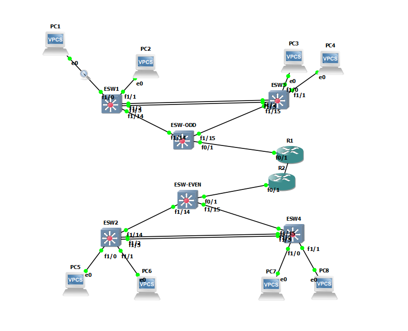
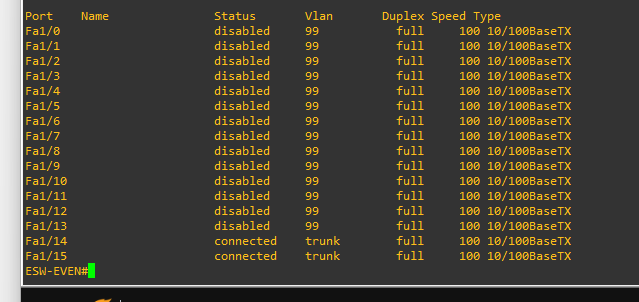
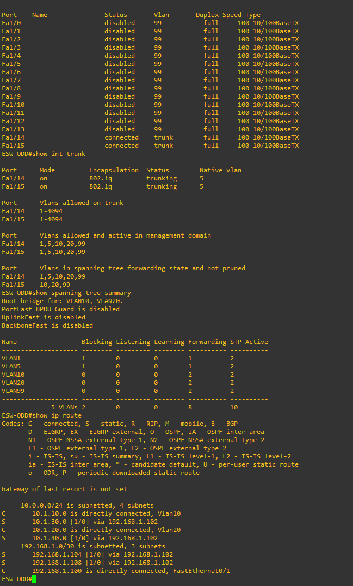
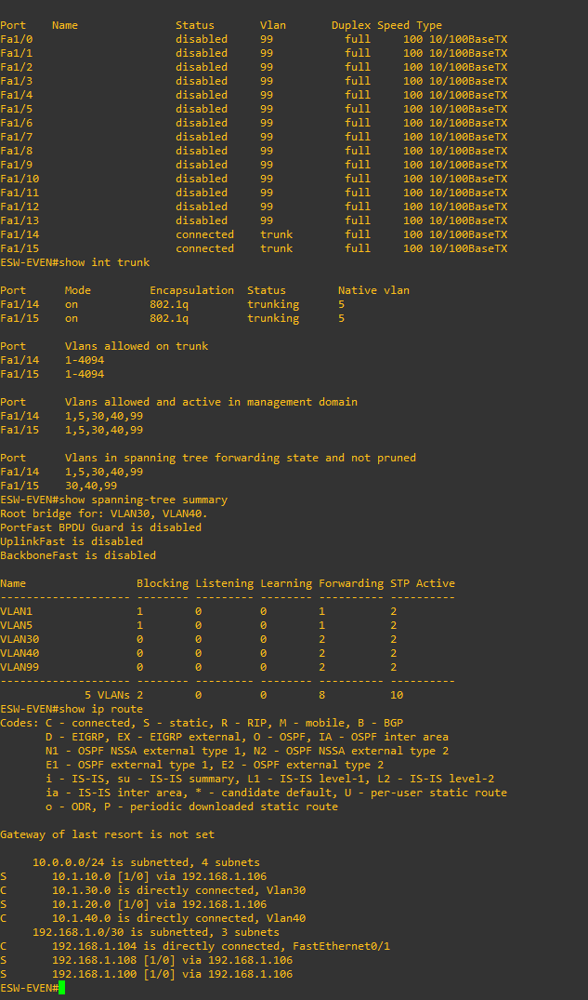

# GNS3 Network Routing Project

**Author:** Lucas Keller  
**Project:** Multi-VLAN Network Design, Static Routing, and Packet Analysis  
**Environment:** GNS3, Cisco IOS-style routers and switches, Wireshark

## 1. Project Overview

This project implements a multi-VLAN network in GNS3 with access switches, Layer 3 distribution switches, routers, and end-host PCs. The goal is to provide connectivity between devices on different networks while maintaining a structured network design.

The project combines several networking concepts, including VLAN segmentation, trunk links, Switch Virtual Interfaces (SVIs), Spanning Tree Protocol (STP), static routing, and packet analysis.

The network uses distribution switches to provide VLAN gateways and route traffic between networks. Additional routers connect separate portions of the network. Static routes tell each Layer 3 device where to forward traffic destined for networks that are not directly connected.

Wireshark is used to examine traffic generated by traceroute and observe how the Time to Live (TTL) field and ICMP messages reveal the path packets take through the network.

## 2. Project Objectives

The main objectives of this project are to:

- Build a multi-tier network topology in GNS3.
- Configure VLANs and assign access ports to the appropriate networks.
- Configure trunk links to carry traffic for multiple VLANs.
- Use SVIs to provide default gateways for end-host devices.
- Configure Layer 3 interfaces between distribution switches and routers.
- Implement static routes to provide connectivity between separate IP networks.
- Verify routing tables and end-to-end connectivity.
- Use STP to manage redundant Layer 2 connections.
- Capture and analyze traceroute traffic in Wireshark.
- Document the network configuration and troubleshooting process.

## 3. Network Architecture

The network uses a tiered design with access switches, distribution switches, routers, and end hosts.

Access switches connect the PCs to the network. VLANs separate devices into distinct Layer 2 broadcast domains. Trunk links carry traffic for multiple VLANs between switches, allowing the relevant VLANs to extend across the network.

The distribution switches provide Layer 3 functionality through SVIs and routed interfaces. Their SVIs act as default gateways for the VLANs they serve. Routed links connect the distribution layer to R1 and R2, allowing traffic to move between different IP networks.

Static routes are configured on the appropriate Layer 3 devices so that traffic can reach remote networks. Because static routes do not automatically adapt to topology changes, each device must have the correct destination network and next-hop address.

### Network Topology



The topology image serves as the main reference for understanding device connections, network segmentation, and the intended paths between endpoints.

## 4. VLANs and Layer 2 Configuration

### VLAN Segmentation

VLANs separate devices into different logical networks, even when they connect to the same physical switching infrastructure. Each VLAN represents a separate broadcast domain.

Communication between different VLANs requires Layer 3 routing. In this project, the distribution switches provide the relevant gateway interfaces and routing functionality.

### Trunk Links

Trunk interfaces carry traffic for multiple VLANs over a single physical connection. They are used between switches when more than one VLAN needs to cross the link.

The project uses native VLAN 5 on trunk interfaces. Configuring the native VLAN consistently helps prevent native VLAN mismatches between connected switches.

### Unused Interfaces

Unused switch interfaces are assigned to VLAN 99 and administratively shut down, following the lab's configuration requirements. This reduces the chance that an unused physical port can be used to gain unintended network access.

### Spanning Tree Protocol

STP helps prevent Layer 2 switching loops when redundant paths exist between switches. The distribution switches are configured to act as root bridges for their appropriate VLANs.

Root bridge selection influences the Layer 2 forwarding topology. STP may block redundant links to prevent loops while retaining an alternate path if the topology changes.

### Switch Configuration Evidence

**ESW-EVEN interface status**



This screenshot documents switch interface status. It can be used to inspect port states and identify which interfaces are active or unused.

**ESW-ODD interface and trunk configuration**



**ESW-EVEN trunk configuration**



These images provide configuration evidence for the switching layer. When reviewing them, check that the intended trunk ports are operational, the native VLAN is consistent, and the appropriate VLANs are available on the relevant links.

## 5. Layer 3 Configuration and Static Routing

### Routed Interfaces

The distribution switches and routers use IP addresses on their routed interfaces to communicate across point-to-point networks.

The documented interface addressing is:

| Device | Interface | IP Address |
|---|---|---|
| ESW-ODD | Routed interface | 192.168.1.101/30 |
| R1 | f0/1 | 192.168.1.102/30 |
| ESW-EVEN | Routed interface | 192.168.1.105/30 |
| R2 | f0/1 | 192.168.1.106/30 |
| R1 | f0/0 | 192.168.1.109/30 |
| R2 | f0/0 | 192.168.1.110/30 |

The /30 prefix provides four addresses per subnet: a network address, two usable host addresses, and a broadcast address. This makes it suitable for point-to-point IPv4 links.

The interface addresses above form three pairs of usable addresses:

- `192.168.1.100/30` connects ESW-ODD and R1.
- `192.168.1.104/30` connects ESW-EVEN and R2.
- `192.168.1.108/30` connects R1 and R2.

These subnet assignments allow each routed connection to use its own small IP network.

### Static Routes

Static routes manually define how a device reaches a remote network. Each route specifies a destination network, subnet mask, and next-hop IP address.

On Cisco IOS-style devices, a static route is configured using:

```text
ip route <destination-network> <subnet-mask> <next-hop-ip>
